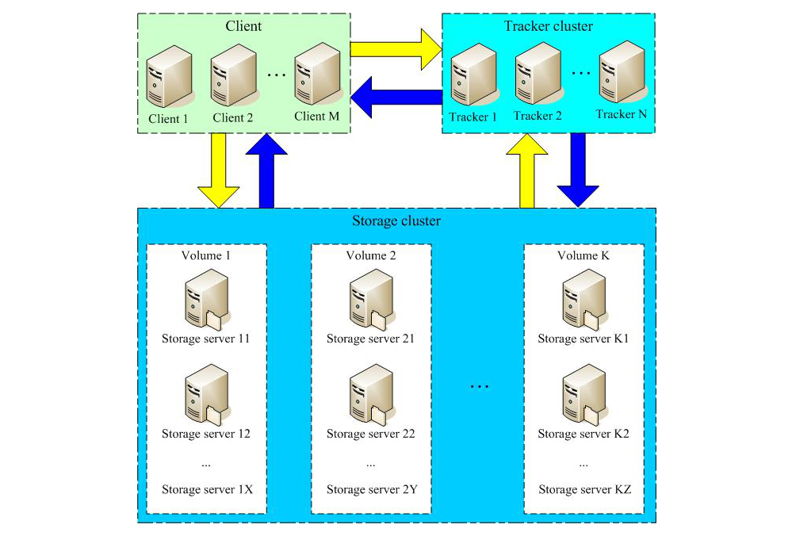

# FastDFS

> 开源的轻量级分布式文件系统，专为互联网大容量文件存储与高性能访问而设计。

## 目录

- [简介](#简介)
- [架构](#架构)
- [主要特性](#主要特性)
- [客户端 SDK](#客户端-sdk)
- [监控](#监控)
- [相关文档](#相关文档)
- [技术支持](#技术支持)

## 简介

FastDFS 是一款开源的分布式文件系统，提供文件存储、文件同步、文件访问（上传、下载）等核心功能，解决了大容量文件存储与高性能访问的问题，特别适合以文件为载体的在线服务，如图片、视频、文档等。

FastDFS 用 C 语言实现，支持 Linux、FreeBSD、MacOS 等类 UNIX 系统。作为轻量级分布式文件系统，V6.13 版本代码量约 7.4 万行。它类似于 Google FS，属于应用级文件系统，而非通用文件系统，只能通过专有 API 访问。

FastDFS 为互联网应用量身定做，可看作基于文件的 key value 存储系统（key 为文件 ID，value 为文件本身），实现了高性能与高扩展性。

## 架构

FastDFS 包含两个核心角色：**Tracker** 和 **Storage**。

- **Tracker**：负责文件访问的调度与负载均衡，管理 Storage 集群状态。
- **Storage**：负责文件存储与管理，包括文件存储、同步、访问接口，以及以 key-value 形式表示的文件元数据。

Tracker 与 Storage 均可由多台服务器组成，集群中的服务器可随时加入或移除而不影响在线服务，Tracker 集群内部为对等结构。

Storage 按 **分组（Group）** 组织：

- 系统由一个或多个 Group 组成，各 Group 间文件相互独立，总容量为所有 Group 容量之和；
- 一个 Group 包含一台或多台 Storage 服务器，组内服务器互为备份、负载均衡；新增服务器时，已有文件会自动同步至新服务器，同步完成后自动上线服务；
- 整体容量不足时，可通过新增 Group 进行扩容。

文件ID(标识)由 **Group 名称 + 文件名** 两部分组成。

架构图如下：

## 主要特性

- 分组存储，简单灵活；
- 对等结构，不存在单点；
- 文件 ID 由 FastDFS 生成，作为文件访问凭证，无需传统的 name server 或 meta server；
- 大、中、小文件均可良好支持；支持小文件合并存储，可存储海量小文件；
- 一台 Storage 支持多块磁盘，支持单盘数据恢复；
- 提供 nginx 扩展模块，可与 nginx 无缝衔接；
- 支持 IPv6、NAT 网络、跨机房或混合云部署；
- 支持读写分离，支持跨机房灾备；
- 提供 appender 类型文件的 truncate、append 和 modify 接口；
- 支持多线程上传（仅适用于 appender 类型文件，通过 truncate + modify 实现）与下载，支持断点续传；
- 存储服务器上可保存文件附加属性。

## 客户端 SDK

FastDFS 提供了多语言客户端 SDK：

| 语言 | 说明 |
|------|------|
| C | 源码目录 `client/`，头文件默认安装到 `/usr/include/fastdfs/` |
| C++ | 源码目录 `cpp_client/` |
| C# | 源码目录 `csharp_client/` |
| PHP | 扩展源码目录 `php_client/` |
| Java | [fastdfs-client-java](https://gitee.com/fastdfs100/fastdfs-client-java) |
| Go | [fastdfs_client_go](https://gitee.com/daitougege/fastdfs_client_go) |
| Python | 源码目录 `python_client/` |
| Ruby | 源码目录 `ruby_client/` |
| Rust | 源码目录 `rust_client/` |
| JavaScript | 源码目录 `javascript_client/` |
| Groovy | 源码目录 `groovy_client/` |

## 监控

V6.15.5 起开始维护和改进第三方贡献的 `fdfs_exporter`，为 Prometheus 提供监控数据，源码目录为 `monitoring/prometheus_exporter/`。执行 `fdfs_exporter -h` 可查看帮助信息。

## 相关文档

- 安装与配置：[Wiki 文档](https://gitee.com/fastdfs100/fastdfs/wikis/Home)
- 重大版本一览：[version-history-zh_CN.md](docs/version-history-zh_CN.md)
- 部署及配置建议：[recommended-deployment-plan_CN.md](docs/recommended-deployment-plan_CN.md)
- 更多功能与特性介绍：搜索微信公众号 **fastdfs**

## 技术支持

FastDFS 是轻量级的对象存储解决方案。如需在数据库、K8s 和虚拟机（如 KVM）等场景使用通用分布式文件系统，可了解保证数据强一致性且高性能的 [FastCFS](https://gitee.com/fastdfs100/FastCFS)。

我们提供商业技术支持和定制化开发，欢迎微信或邮件洽谈。

email: 384681(at)qq(dot)com
